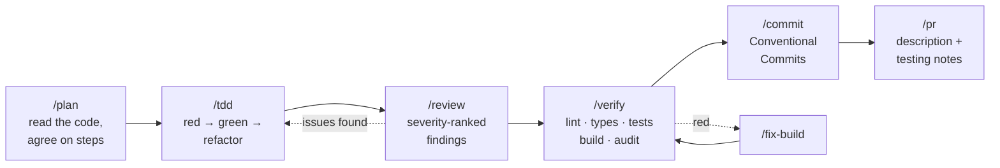

<p align="center">
  
</p>

<p align="center">
  <strong>Language:</strong>
  English |
  <a href="docs/es/README.md">Español</a>
</p>

<p align="center">
  <a href="https://github.com/salmeronvictor486-lang/Rounded-desktop/actions/workflows/ci.yml"></a>
  <a href="LICENSE"></a>
  <a href="https://github.com/salmeronvictor486-lang/Rounded-desktop/stargazers"></a>
  <a href="https://github.com/salmeronvictor486-lang/Rounded-desktop/network/members"></a>
  <a href="CONTRIBUTING.md"></a>
</p>

<p align="center">
  
  
  
  
  
  
</p>

<p align="center">
  
  
  
  
  
  
</p>

<h3 align="center">Your AI coding agent is fast. Rounded makes it careful.</h3>

<p align="center">
  Specialist agents, battle-tested skills, one-word workflows and safety hooks that encode how<br/>
  senior engineers <strong>plan, test, review, secure and ship</strong> software — installed into the tool you already use.
</p>

<div align="center">

<table aria-label="Rounded primary links">
<tr>
<td width="25%" align="center">
  <a href="#quick-start"><br /><strong>Quick start</strong></a><br />
  <sub>Running in under a minute</sub>
</td>
<td width="25%" align="center">
  <a href="docs/CATALOG.md"><br /><strong>Catalog</strong></a><br />
  <sub>All agents, skills, commands</sub>
</td>
<td width="25%" align="center">
  <a href="#safety-hooks"><br /><strong>Safety hooks</strong></a><br />
  <sub>Stop disasters before they run</sub>
</td>
<td width="25%" align="center">
  <a href="CONTRIBUTING.md"><br /><strong>Contribute</strong></a><br />
  <sub>Skills, languages, translations</sub>
</td>
</tr>
</table>

</div>

<p align="center">
  
</p>

---

## ✨ Why Rounded?

AI coding agents write code at incredible speed — and make the same mistakes a rushed junior would: skipping tests, guessing at bugs, hard-coding secrets, force-pushing over `main`, forgetting what they were doing after a long session. Rounded fixes the *process*, not the model.

| Without Rounded | With Rounded |
|---|---|
| "Let me just start coding…" | `/plan` reads the code first and writes a step-by-step plan you approve |
| Tests written last, if at all | `/tdd` drives every change red → green → refactor |
| "The bug is probably here" | `/debug` reproduces, bisects and proves the root cause, then leaves a regression test |
| Self-review is "looks good" | `/review` runs a severity-ranked review with a concrete failure scenario for every finding |
| `git push --force origin main` | **Blocked** by `guard-bash` before it runs |
| `const key = "sk_live_…"` | **Blocked** by `secret-scan`; the agent uses an environment variable |
| Context lost after compaction | `save-session` + `/checkpoint` + `/resume` carry the thread across sessions |
| One tool's config, copied by hand | One source of truth installed into **Claude Code, Codex, Cursor, Gemini CLI and OpenCode** |

Everything is **plain Markdown** plus a **zero-dependency Node.js installer** — readable, forkable, yours.

<a id="quick-start"></a>

## 🚀 Quick start

### Claude Code — install as a plugin (recommended)

```text
/plugin marketplace add salmeronvictor486-lang/Rounded-desktop
/plugin install rounded@rounded
```

Restart Claude Code, then try:

```text
/rounded:plan add rate limiting to the login endpoint
```

Want the always-on rules too? Plugins cannot add `CLAUDE.md` instructions, so add them with one command:

```bash
npx github:salmeronvictor486-lang/Rounded-desktop install --only rules
```

### Every other tool — one command

```bash
npx github:salmeronvictor486-lang/Rounded-desktop install --target claude,codex,gemini,opencode
```

<details>
<summary><strong>More install recipes</strong></summary>

```bash
# Everything (all 12 agents and 24 skills) instead of the core set
npx github:salmeronvictor486-lang/Rounded-desktop install --profile full

# One project only — languages are detected from package.json, pyproject.toml, go.mod, Cargo.toml
npx github:salmeronvictor486-lang/Rounded-desktop install --target cursor,claude --dir ./my-app

# Pick languages explicitly
npx github:salmeronvictor486-lang/Rounded-desktop install --languages typescript,python

# See exactly what would change, without writing anything
npx github:salmeronvictor486-lang/Rounded-desktop install --target all --dry-run

# Check your setup / remove everything
npx github:salmeronvictor486-lang/Rounded-desktop doctor
npx github:salmeronvictor486-lang/Rounded-desktop uninstall
```

Prefer a local clone? `git clone` the repository and run `./install.sh` (macOS/Linux) or `.\install.ps1` (Windows) with the same options.

</details>

<details>
<summary><strong>Is it safe to run on my existing setup?</strong></summary>

Yes — that was a design goal:

- Files you created or edited are **never overwritten or deleted** unless you pass `--force`.
- Shared files (`CLAUDE.md`, `AGENTS.md`, `GEMINI.md`, `settings.json`) are touched only inside a clearly marked Rounded block or Rounded's own hook entries.
- `uninstall` restores them exactly as they were, and removes only what Rounded wrote.
- Everything installed is recorded in `~/.rounded/installs/`, so upgrades remove what is no longer selected.

</details>

## 🧭 The workflow



Long task or end of the day? **`/checkpoint`** commits finished work and writes `.rounded/handoff.md`. The next session shows it automatically, and **`/resume`** picks up exactly where you left off.

## 📦 What's inside

```text
rounded/
├── agents/           12 specialist subagents the main agent delegates to
├── skills/           24 deep-dive playbooks loaded only when relevant
├── commands/         18 one-word workflows: /plan, /tdd, /review, /verify, …
├── rules/
│   ├── common/       always-on engineering rules for every project
│   └── typescript/ python/ go/ rust/   language rules, attached by file type
├── hooks/            7 safety & continuity hooks (Node.js, zero dependencies)
├── .claude-plugin/   Claude Code plugin + marketplace manifests
└── bin/ src/         the installer for Claude Code, Codex, Cursor, Gemini CLI, OpenCode
```

<details>
<summary><strong>🤖 Agents — which one should I use?</strong></summary>

| When you need to… | Agent |
|---|---|
| Turn a request into an ordered, file-by-file plan | `planner` |
| Choose between designs, record an ADR | `architect` |
| Review a diff or branch before merging | `code-reviewer` |
| Audit input handling, auth, secrets, dependencies | `security-reviewer` |
| Build a feature or fix a bug test-first | `tdd-guide` |
| Get a red build, type check or lint back to green | `build-fixer` |
| Find the root cause of a bug or flaky test | `debugger` |
| Clean up code without changing behaviour | `refactorer` |
| Write and stabilise end-to-end browser tests | `e2e-tester` |
| Bring docs, READMEs and changelogs in line with the code | `doc-writer` |
| Make something measurably faster | `performance-analyst` |
| Review schemas, migrations and queries | `database-reviewer` |

</details>

<details>
<summary><strong>🧠 Skills</strong></summary>

| Area | Skills |
|---|---|
| Workflow | `tdd-workflow` · `writing-tests` · `code-review` · `systematic-debugging` · `refactoring-safely` · `git-workflow` · `context-management` |
| Quality & safety | `security-review` · `error-handling` · `logging-and-observability` · `performance-profiling` · `dependency-hygiene` |
| Design & data | `api-design` · `database-migrations` · `frontend-accessibility` |
| Shipping | `ci-pipelines` · `containers-and-deploy` · `release-management` · `writing-docs` |
| Languages | `typescript-patterns` · `python-patterns` · `go-patterns` · `rust-patterns` · `react-patterns` |

Skills cost almost nothing until they are needed: the agent sees a one-line description and loads the full playbook only when the task matches.

</details>

<details>
<summary><strong>⚡ Commands cheat sheet</strong></summary>

| Command | What it does |
|---|---|
| `/plan <change>` | Explore the code and write an approved, step-by-step plan |
| `/tdd <behaviour>` | Implement test-first with a red-green-refactor loop |
| `/review [base]` | Severity-ranked review of your changes |
| `/security-check [area]` | Vulnerability and secret audit |
| `/verify [quick\|full]` | Run every quality gate and give a ready / not-ready verdict |
| `/fix-build [command]` | Fix a failing build honestly — no `@ts-ignore`, no skipped tests |
| `/debug <symptom>` | Root cause with evidence, fix and regression test |
| `/refactor <area>` | Behaviour-preserving cleanup protected by tests |
| `/test-coverage [path]` | Find the riskiest untested code and test it |
| `/commit` | Conventional Commits message from the staged diff |
| `/pr [base]` | Pull request description with testing and risk notes |
| `/checkpoint` · `/resume` | Save a handoff note · pick up from it |
| `/explain <code>` · `/onboard` | Understand a flow · map an unfamiliar codebase |
| `/docs` · `/deps-audit` · `/release-notes` | Sync docs · audit dependencies · draft release notes |

</details>

Full descriptions of all 12 agents, 24 skills, 18 commands and 14 rules: **[docs/CATALOG.md](docs/CATALOG.md)**.

<a id="safety-hooks"></a>

## 🛡️ Safety hooks

Hooks run automatically on Claude Code events. They are tiny, fast, dependency-free scripts that **fail open** — a hook bug never breaks your session — and every rule is covered by tests.

| Hook | When | What it does |
|---|---|---|
| 🧱 `guard-bash` | before shell commands | **Blocks** `rm -rf /` and home/system folders, disk wipes, fork bombs, force-pushes to `main`/`master`/`release`. **Asks** before `git reset --hard`, `git clean -f`, `--no-verify`, `curl \| sh`, `npm publish`, `terraform destroy`, `DROP TABLE`… |
| 🔑 `secret-scan` | before writing files | Refuses API keys, tokens, private keys and passwords-in-URLs in source files (AWS, GitHub, Stripe, OpenAI, Anthropic, Slack and more) |
| 🗂️ `guard-paths` | before writing files | Protects `.git/`; asks before hand-editing lockfiles and installed dependencies |
| 🐛 `debug-statements` | after edits | Flags freshly added `console.log`, `debugger`, `breakpoint()`, `dbg!`… |
| 🧭 `session-start` | session start | Injects project facts: stack, branch, uncommitted work, test/build commands, your handoff note |
| 💾 `save-session` | compaction & session end | Remembers recent requests and changed files for next time |
| ✅ `stop-check` | before finishing (strict) | Asks for tests when code changed without any test change |

```bash
export ROUNDED_HOOK_PROFILE=strict                 # minimal | standard (default) | strict
export ROUNDED_DISABLED_HOOKS=debug-statements     # switch off individual hooks
```

Deep dive: **[docs/hooks.md](docs/hooks.md)**.

## 🔌 Works with your tools

| | Claude Code | Codex CLI | Cursor | Gemini CLI | OpenCode <sup>beta</sup> |
|---|:---:|:---:|:---:|:---:|:---:|
| Agents | ✅ | — | — | — | ✅ |
| Skills | ✅ | ✅ | — | — | — |
| Commands | ✅ | — | ✅ | ✅ | ✅ |
| Rules | ✅ | ✅ | ✅ | ✅ | ✅ |
| Hooks | ✅ | — | — | — | — |
| Install scope | user · project | user · project | project | user · project | user · project |

One source of truth, translated into each tool's native format (`.mdc` rules for Cursor, TOML commands for Gemini, `AGENTS.md` for Codex and OpenCode…). Where a tool has no equivalent feature, Rounded leaves it out instead of faking it. Details: **[docs/harnesses.md](docs/harnesses.md)**.

## 🎛️ Profiles

| Profile | You get |
|---|---|
| **`core`** (default) | The essentials: planner, code-reviewer, security-reviewer, tdd-guide, build-fixer and debugger; the workflow skills; nine everyday commands; common rules; hooks; plus language rules and skills for the languages you use |
| **`full`** | Everything in the catalog |

React projects automatically get the React and accessibility skills too.

## 💡 Key ideas

<details>
<summary><strong>Agents, skills, commands, rules and hooks — what's the difference?</strong></summary>

- **Agents** are specialists with their own instructions and tool permissions. The main agent hands them a focused job (review this diff, find this bug) and gets back a conclusion, keeping its own context clean.
- **Skills** are playbooks — checklists, safe and unsafe patterns, commands — loaded only when the task matches their description.
- **Commands** are one-word workflows you trigger on purpose: `/plan`, `/review`, `/verify`.
- **Rules** are short, always-on standards (tests for every change, no secrets in code, Conventional Commits).
- **Hooks** are code, not advice: they run on every tool call and can actually stop a dangerous action.

</details>

<details>
<summary><strong>How much context does it cost?</strong></summary>

Claude Code reports roughly **3.8k always-on tokens** for the full plugin — mostly one-line descriptions of skills and agents. Full playbooks load only when used. Rules are deliberately short (each under 60 lines; the validator enforces it), and the `core` profile installs less.

</details>

<details>
<summary><strong>Do hooks make my agent completely safe?</strong></summary>

No — they are a safety net, not a sandbox. They reliably catch the common, catastrophic mistakes with very few false positives, but a deliberately obfuscated command can get past any pattern matcher. Keep version control, reviews, branch protection and least-privilege credentials.

</details>

<details>
<summary><strong>Can I customise it?</strong></summary>

Absolutely. Every file is Markdown you can edit after installing (Rounded will not overwrite your edits), or fork the repository and adjust the source. The **[authoring guide](docs/authoring.md)** shows the format for each kind of content, and `npm run check` validates your changes.

</details>

## 🗺️ Roadmap

- [x] 12 agents, 24 skills, 18 commands, 14 rules
- [x] Safety & continuity hooks with profiles
- [x] Installer for Claude Code, Codex CLI, Cursor, Gemini CLI and OpenCode
- [ ] More languages: Java/Kotlin, C#, Ruby, PHP, Swift
- [ ] More skills: GraphQL, mobile, data engineering, infrastructure as code
- [ ] Hook support for more tools as they add hook systems
- [ ] Translations of this page into more languages
- [ ] Published npm package and a public plugin directory listing

Ideas welcome — [open an issue](https://github.com/salmeronvictor486-lang/Rounded-desktop/issues/new/choose).

## 🤝 Contributing

New skills, sharper agents, more languages and tools, translations — all welcome. Read **[CONTRIBUTING.md](CONTRIBUTING.md)** and the **[authoring guide](docs/authoring.md)**, then:

```bash
npm run catalog   # regenerate the catalog
npm run check     # validate all content + run the test suite
```

Found a way around a hook or a vulnerability? Please report it privately — see **[SECURITY.md](SECURITY.md)**.

## ⭐ Star history

<a href="https://star-history.com/#salmeronvictor486-lang/Rounded-desktop&Date">
  <picture>
    <source media="(prefers-color-scheme: dark)" srcset="https://api.star-history.com/svg?repos=salmeronvictor486-lang/Rounded-desktop&type=Date&theme=dark" />
    
  </picture>
</a>

If Rounded saves you from one bad force-push, consider giving it a ⭐ — it helps other developers find it.

## 📄 License

[MIT](LICENSE) — free for personal and commercial use. Fork it, adapt it to your team, share what you build.

<p align="center">
  <br/>
  <sub>Made for developers who want their AI to code like a senior engineer.</sub>
</p>
