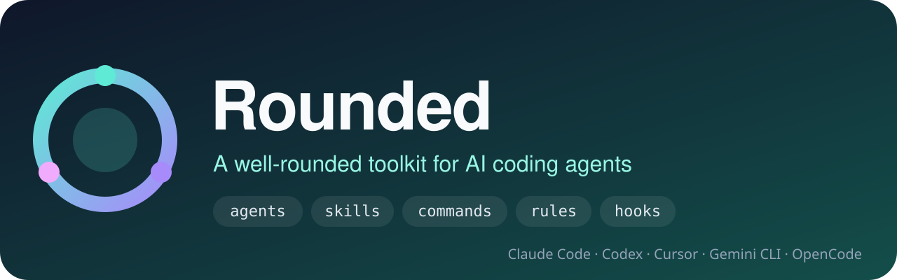
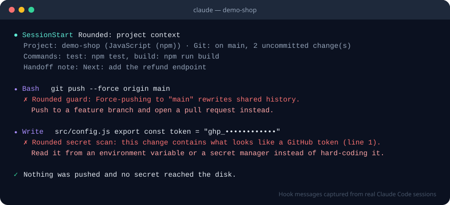
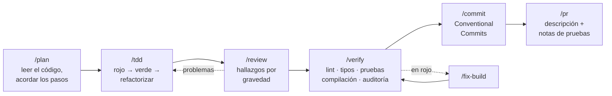

<p align="center">
  
</p>

<p align="center">
  <strong>Idioma:</strong>
  <a href="../../README.md">English</a> |
  Español
</p>

<p align="center">
  <a href="https://github.com/salmeronvictor486-lang/Rounded-desktop/actions/workflows/ci.yml"></a>
  <a href="../../LICENSE"></a>
  <a href="https://github.com/salmeronvictor486-lang/Rounded-desktop/stargazers"></a>
  <a href="https://github.com/salmeronvictor486-lang/Rounded-desktop/network/members"></a>
  <a href="../../CONTRIBUTING.md"></a>
</p>

<p align="center">
  
  
  
  
  
  
</p>

<p align="center">
  
  
  
  
  
  
</p>

<h3 align="center">Tu agente de programación con IA es rápido. Rounded lo hace cuidadoso.</h3>

<p align="center">
  Agentes especializados, skills probadas, flujos de trabajo de una palabra y hooks de seguridad que recogen cómo<br/>
  los ingenieros con experiencia <strong>planifican, prueban, revisan, protegen y publican</strong> software, instalados en la herramienta que ya usas.
</p>

<div align="center">

<table aria-label="Enlaces principales de Rounded">
<tr>
<td width="25%" align="center">
  <a href="#inicio-rapido"><br /><strong>Inicio rápido</strong></a><br />
  <sub>Funcionando en menos de un minuto</sub>
</td>
<td width="25%" align="center">
  <a href="../CATALOG.md"><br /><strong>Catálogo</strong></a><br />
  <sub>Agentes, skills y comandos</sub>
</td>
<td width="25%" align="center">
  <a href="#hooks-de-seguridad"><br /><strong>Hooks de seguridad</strong></a><br />
  <sub>Frenan desastres antes de ocurrir</sub>
</td>
<td width="25%" align="center">
  <a href="../../CONTRIBUTING.md"><br /><strong>Contribuir</strong></a><br />
  <sub>Skills, lenguajes, traducciones</sub>
</td>
</tr>
</table>

</div>

<p align="center">
  
</p>

---

## ✨ ¿Por qué Rounded?

Los agentes de programación con IA escriben código a una velocidad increíble y cometen los mismos errores que alguien con prisa: se saltan las pruebas, adivinan dónde está el fallo, dejan claves en el código, hacen `push --force` sobre `main` y olvidan qué estaban haciendo tras una sesión larga. Rounded corrige el *proceso*, no el modelo.

| Sin Rounded | Con Rounded |
|---|---|
| «Empiezo a programar y ya veremos…» | `/plan` lee primero el código y escribe un plan paso a paso que tú apruebas |
| Las pruebas, al final, si acaso | `/tdd` guía cada cambio: rojo → verde → refactorizar |
| «El fallo seguramente está aquí» | `/debug` reproduce, acota y demuestra la causa raíz, y deja una prueba de regresión |
| La autorrevisión es «se ve bien» | `/review` hace una revisión ordenada por gravedad, con un escenario de fallo concreto para cada hallazgo |
| `git push --force origin main` | **Bloqueado** por `guard-bash` antes de ejecutarse |
| `const key = "sk_live_…"` | **Bloqueado** por `secret-scan`; el agente usa una variable de entorno |
| Contexto perdido tras compactar | `save-session` + `/checkpoint` + `/resume` mantienen el hilo entre sesiones |
| Configuración copiada a mano entre herramientas | Una sola fuente instalada en **Claude Code, Codex, Cursor, Gemini CLI y OpenCode** |

Todo es **Markdown** más un **instalador en Node.js sin dependencias**: fácil de leer, de adaptar y tuyo. El contenido está en inglés para llegar a más gente; los agentes te responden en el idioma en que les hables.

<a id="inicio-rapido"></a>

## 🚀 Inicio rápido

### Claude Code: como plugin (recomendado)

```text
/plugin marketplace add salmeronvictor486-lang/Rounded-desktop
/plugin install rounded@rounded
```

Reinicia Claude Code y prueba:

```text
/rounded:plan añadir límite de intentos al inicio de sesión
```

¿Quieres también las reglas siempre activas? Los plugins no pueden añadir instrucciones a `CLAUDE.md`, así que se instalan con un comando:

```bash
npx github:salmeronvictor486-lang/Rounded-desktop install --only rules
```

### Cualquier otra herramienta: un comando

```bash
npx github:salmeronvictor486-lang/Rounded-desktop install --target claude,codex,gemini,opencode
```

<details>
<summary><strong>Más formas de instalar</strong></summary>

```bash
# Todo (los 12 agentes y las 24 skills) en lugar del conjunto básico
npx github:salmeronvictor486-lang/Rounded-desktop install --profile full

# Solo un proyecto: los lenguajes se detectan en package.json, pyproject.toml, go.mod y Cargo.toml
npx github:salmeronvictor486-lang/Rounded-desktop install --target cursor,claude --dir ./mi-app

# Elegir los lenguajes
npx github:salmeronvictor486-lang/Rounded-desktop install --languages typescript,python

# Ver qué cambiaría, sin escribir nada
npx github:salmeronvictor486-lang/Rounded-desktop install --target all --dry-run

# Revisar la instalación / quitarlo todo
npx github:salmeronvictor486-lang/Rounded-desktop doctor
npx github:salmeronvictor486-lang/Rounded-desktop uninstall
```

¿Prefieres una copia local? Clona el repositorio y ejecuta `./install.sh` (macOS/Linux) o `.\install.ps1` (Windows) con las mismas opciones.

</details>

<details>
<summary><strong>¿Es seguro instalarlo sobre mi configuración actual?</strong></summary>

Sí, es uno de los objetivos del diseño:

- Los archivos que tú creaste o editaste **nunca se sobrescriben ni se borran**, salvo con `--force`.
- Los archivos compartidos (`CLAUDE.md`, `AGENTS.md`, `GEMINI.md`, `settings.json`) solo se tocan dentro de un bloque de Rounded bien marcado o en sus propias entradas de hooks.
- `uninstall` los deja exactamente como estaban y solo quita lo que escribió Rounded.
- Todo lo instalado queda registrado en `~/.rounded/installs/`, así que las actualizaciones quitan lo que ya no está seleccionado.

</details>

## 🧭 El flujo de trabajo



¿Tarea larga o fin del día? **`/checkpoint`** guarda el trabajo terminado y escribe `.rounded/handoff.md`. La siguiente sesión lo muestra automáticamente y **`/resume`** continúa justo donde lo dejaste.

## 📦 Qué incluye

```text
rounded/
├── agents/           12 agentes especializados en los que delega el agente principal
├── skills/           24 guías a fondo que se cargan solo cuando hacen falta
├── commands/         18 flujos de una palabra: /plan, /tdd, /review, /verify, …
├── rules/
│   ├── common/       reglas de ingeniería siempre activas
│   └── typescript/ python/ go/ rust/   reglas por lenguaje, según el tipo de archivo
├── hooks/            7 hooks de seguridad y continuidad (Node.js, sin dependencias)
├── .claude-plugin/   manifiestos del plugin y del marketplace de Claude Code
└── bin/ src/         el instalador para Claude Code, Codex, Cursor, Gemini CLI y OpenCode
```

<details>
<summary><strong>🤖 Agentes: ¿cuál uso?</strong></summary>

| Cuando necesitas… | Agente |
|---|---|
| Convertir una petición en un plan ordenado, archivo por archivo | `planner` |
| Elegir entre diseños y dejar constancia de la decisión | `architect` |
| Revisar un diff o una rama antes de fusionar | `code-reviewer` |
| Auditar entradas, autenticación, secretos y dependencias | `security-reviewer` |
| Programar una función o arreglar un fallo empezando por la prueba | `tdd-guide` |
| Volver a verde una compilación, los tipos o el lint | `build-fixer` |
| Encontrar la causa raíz de un fallo o de una prueba inestable | `debugger` |
| Limpiar código sin cambiar su comportamiento | `refactorer` |
| Escribir y estabilizar pruebas de extremo a extremo | `e2e-tester` |
| Poner al día la documentación con el código | `doc-writer` |
| Hacer algo medible y realmente más rápido | `performance-analyst` |
| Revisar esquemas, migraciones y consultas | `database-reviewer` |

</details>

<details>
<summary><strong>🧠 Skills</strong></summary>

| Área | Skills |
|---|---|
| Flujo de trabajo | `tdd-workflow` · `writing-tests` · `code-review` · `systematic-debugging` · `refactoring-safely` · `git-workflow` · `context-management` |
| Calidad y seguridad | `security-review` · `error-handling` · `logging-and-observability` · `performance-profiling` · `dependency-hygiene` |
| Diseño y datos | `api-design` · `database-migrations` · `frontend-accessibility` |
| Publicación | `ci-pipelines` · `containers-and-deploy` · `release-management` · `writing-docs` |
| Lenguajes | `typescript-patterns` · `python-patterns` · `go-patterns` · `rust-patterns` · `react-patterns` |

Las skills apenas ocupan contexto hasta que se necesitan: el agente ve una descripción de una línea y carga la guía completa solo cuando la tarea encaja.

</details>

<details>
<summary><strong>⚡ Chuleta de comandos</strong></summary>

| Comando | Qué hace |
|---|---|
| `/plan <cambio>` | Explora el código y escribe un plan paso a paso para aprobar |
| `/tdd <comportamiento>` | Implementa empezando por la prueba (rojo-verde-refactorizar) |
| `/review [rama base]` | Revisión de tus cambios ordenada por gravedad |
| `/security-check [zona]` | Auditoría de vulnerabilidades y secretos |
| `/verify [quick\|full]` | Pasa todos los controles y dice si está listo o no |
| `/fix-build [comando]` | Arregla la compilación sin trampas: nada de `@ts-ignore` ni pruebas desactivadas |
| `/debug <síntoma>` | Causa raíz con pruebas, arreglo y prueba de regresión |
| `/refactor <zona>` | Limpieza sin cambiar el comportamiento, protegida por pruebas |
| `/test-coverage [ruta]` | Encuentra el código sin probar más arriesgado y lo prueba |
| `/commit` | Mensaje Conventional Commits a partir del diff preparado |
| `/pr [rama base]` | Descripción del pull request con notas de pruebas y riesgos |
| `/checkpoint` · `/resume` | Guarda una nota de relevo · continúa desde ella |
| `/explain <código>` · `/onboard` | Entender un flujo · orientarse en un proyecto nuevo |
| `/docs` · `/deps-audit` · `/release-notes` | Documentación al día · auditoría de dependencias · notas de versión |

</details>

Descripción completa de los 12 agentes, 24 skills, 18 comandos y 14 reglas: **[docs/CATALOG.md](../CATALOG.md)**.

<a id="hooks-de-seguridad"></a>

## 🛡️ Hooks de seguridad

Los hooks se ejecutan solos en los eventos de Claude Code. Son scripts pequeños, rápidos y sin dependencias que **nunca bloquean tu sesión por un error propio**, y cada regla está cubierta por pruebas.

| Hook | Cuándo | Qué hace |
|---|---|---|
| 🧱 `guard-bash` | antes de comandos de terminal | **Bloquea** `rm -rf /` y carpetas del sistema o personales, borrado de discos, *fork bombs* y `push --force` a `main`/`master`/`release`. **Pide confirmación** antes de `git reset --hard`, `git clean -f`, `--no-verify`, `curl \| sh`, `npm publish`, `terraform destroy`, `DROP TABLE`… |
| 🔑 `secret-scan` | antes de escribir archivos | Rechaza claves de API, tokens, claves privadas y contraseñas en URLs dentro del código (AWS, GitHub, Stripe, OpenAI, Anthropic, Slack y más) |
| 🗂️ `guard-paths` | antes de escribir archivos | Protege `.git/` y pide confirmación antes de editar a mano lockfiles y dependencias instaladas |
| 🐛 `debug-statements` | después de editar | Señala `console.log`, `debugger`, `breakpoint()`, `dbg!`… recién añadidos |
| 🧭 `session-start` | al empezar la sesión | Añade datos del proyecto: tecnologías, rama, cambios pendientes, comandos de pruebas y compilación, y tu nota de relevo |
| 💾 `save-session` | al compactar y al cerrar | Recuerda las últimas peticiones y los archivos cambiados para la próxima vez |
| ✅ `stop-check` | antes de terminar (estricto) | Pide pruebas si cambió código sin cambiar ninguna prueba |

```bash
export ROUNDED_HOOK_PROFILE=strict                 # minimal | standard (por defecto) | strict
export ROUNDED_DISABLED_HOOKS=debug-statements     # desactivar hooks concretos
```

Todos los detalles: **[docs/hooks.md](../hooks.md)**.

## 🔌 Compatible con tus herramientas

| | Claude Code | Codex CLI | Cursor | Gemini CLI | OpenCode <sup>beta</sup> |
|---|:---:|:---:|:---:|:---:|:---:|
| Agentes | ✅ | — | — | — | ✅ |
| Skills | ✅ | ✅ | — | — | — |
| Comandos | ✅ | — | ✅ | ✅ | ✅ |
| Reglas | ✅ | ✅ | ✅ | ✅ | ✅ |
| Hooks | ✅ | — | — | — | — |
| Ámbito | usuario · proyecto | usuario · proyecto | proyecto | usuario · proyecto | usuario · proyecto |

Una sola fuente, traducida al formato propio de cada herramienta (reglas `.mdc` en Cursor, comandos TOML en Gemini, `AGENTS.md` en Codex y OpenCode…). Si una herramienta no tiene algo equivalente, Rounded no lo imita a medias. Detalles: **[docs/harnesses.md](../harnesses.md)**.

## 🎛️ Perfiles

| Perfil | Incluye |
|---|---|
| **`core`** (por defecto) | Lo esencial: planner, code-reviewer, security-reviewer, tdd-guide, build-fixer y debugger; las skills de flujo de trabajo; nueve comandos de uso diario; reglas comunes; hooks; y las reglas y skills de los lenguajes que uses |
| **`full`** | Todo el catálogo |

Los proyectos con React reciben además las skills de React y de accesibilidad.

## 💡 Ideas clave

<details>
<summary><strong>Agentes, skills, comandos, reglas y hooks: ¿en qué se diferencian?</strong></summary>

- **Agentes:** especialistas con sus propias instrucciones y permisos. El agente principal les encarga un trabajo concreto (revisar este diff, encontrar este fallo) y recibe la conclusión, sin llenar su propio contexto.
- **Skills:** guías con listas de comprobación, patrones seguros e inseguros y comandos, que se cargan solo cuando la tarea encaja.
- **Comandos:** flujos de una palabra que lanzas tú: `/plan`, `/review`, `/verify`.
- **Reglas:** normas breves siempre activas (pruebas para cada cambio, nada de secretos en el código, Conventional Commits).
- **Hooks:** código, no consejos: se ejecutan en cada acción y pueden detener de verdad una operación peligrosa.

</details>

<details>
<summary><strong>¿Cuánto contexto ocupa?</strong></summary>

Claude Code informa de unos **3.800 tokens fijos** para el plugin completo, casi todo descripciones de una línea de skills y agentes. Las guías completas solo se cargan al usarlas. Las reglas son cortas a propósito (menos de 60 líneas cada una; el validador lo comprueba) y el perfil `core` instala menos.

</details>

<details>
<summary><strong>¿Los hooks hacen mi agente totalmente seguro?</strong></summary>

No: son una red de seguridad, no un entorno aislado. Detectan con fiabilidad los errores catastróficos más comunes con muy pocos falsos positivos, pero un comando ofuscado a propósito puede esquivar cualquier filtro por patrones. Sigue usando control de versiones, revisiones, protección de ramas y credenciales con los mínimos permisos.

</details>

<details>
<summary><strong>¿Puedo adaptarlo?</strong></summary>

Claro. Todos los archivos son Markdown que puedes editar después de instalarlos (Rounded no sobrescribe tus cambios), o puedes hacer un fork y modificar el original. La **[guía de autoría](../authoring.md)** explica el formato de cada tipo de contenido y `npm run check` valida tus cambios.

</details>

## 🗺️ Hoja de ruta

- [x] 12 agentes, 24 skills, 18 comandos, 14 reglas
- [x] Hooks de seguridad y continuidad con perfiles
- [x] Instalador para Claude Code, Codex CLI, Cursor, Gemini CLI y OpenCode
- [ ] Más lenguajes: Java/Kotlin, C#, Ruby, PHP, Swift
- [ ] Más skills: GraphQL, móvil, ingeniería de datos, infraestructura como código
- [ ] Hooks para más herramientas a medida que incorporen sistemas de hooks
- [ ] Traducciones de esta página a más idiomas
- [ ] Paquete publicado en npm y presencia en el directorio público de plugins

Las ideas son bienvenidas: [abre un issue](https://github.com/salmeronvictor486-lang/Rounded-desktop/issues/new/choose).

## 🤝 Contribuir

Nuevas skills, agentes más afinados, más lenguajes y herramientas, traducciones: todo suma. Lee **[CONTRIBUTING.md](../../CONTRIBUTING.md)** y la **[guía de autoría](../authoring.md)** y después:

```bash
npm run catalog   # regenera el catálogo
npm run check     # valida el contenido y ejecuta las pruebas
```

¿Has encontrado una forma de esquivar un hook o una vulnerabilidad? Avisa en privado, como explica **[SECURITY.md](../../SECURITY.md)**.

## ⭐ Evolución de estrellas

<a href="https://star-history.com/#salmeronvictor486-lang/Rounded-desktop&Date">
  <picture>
    <source media="(prefers-color-scheme: dark)" srcset="https://api.star-history.com/svg?repos=salmeronvictor486-lang/Rounded-desktop&type=Date&theme=dark" />
    
  </picture>
</a>

Si Rounded te libra de un solo `push --force` desastroso, dale una ⭐: ayuda a que otros desarrolladores lo encuentren.

## 📄 Licencia

[MIT](../../LICENSE): gratis para uso personal y comercial. Haz un fork, adáptalo a tu equipo y comparte lo que construyas.

<p align="center">
  <br/>
  <sub>Hecho para quienes quieren que su IA programe como una persona con experiencia.</sub>
</p>
